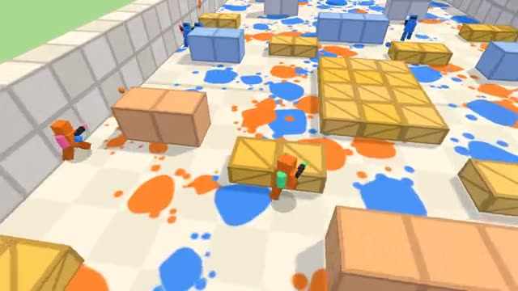

# Paint CTF

Steal their flag. Paint the arena your color. A multiplayer starter game from [Multiplayer Agent](https://multiplayeragent.com): 3D, versus, 2–10 players in two teams, with bots that fill both teams.

## How it plays

Two teams with paint blasters. Run into the other team's base, grab their flag and carry it to your own stand while your flag is safe at home. Three hits splat you; first team to 3 captures wins.

**Controls:** WASD and mouse, click to shoot, Space to jump. On a phone: left thumb moves, drag to look, FIRE shoots.

## Make it yours in the Game Builder

Open the [Game Builder](https://multiplayeragent.com), choose **Start from a starter game** and pick Paint CTF. It opens as version 1 in your studio, ready to play and publish. Then ask for changes, for example:

- Make players run faster on their own team's paint
- Add a paint grenade that splats a whole area
- Move the arena onto a pirate ship deck

## Run it yourself

1. Get a free publishable key (`pk_…`) at [multiplayeragent.com](https://multiplayeragent.com).
2. In `index.html`, put it in place of `pk_REPLACE_ME` in the `MP_CONNECT` block.
3. Serve the folder (for example `npx serve`) and open it. The 3D engine loads as a module, which browsers block from a file on disk.

Without a key it still runs, offline against bots.

## How it is built

- One `index.html` plus three.js in `libs/`. The comment at the top of the script maps the code and explains the multiplayer. The arena is the `HALF_MAP` text block under `CONFIG`: edit the characters of the left half and the right half mirrors it.
- **Leaderboard:** The most points anyone has scored in one match.
- **Host-run rules:** One player's browser decides every flag grab, drop and capture, and keeps the score; if it leaves, the next player takes over.
- **Bots:** Bots fill both teams: some attack, some guard the flag.
- **Live sync:** Every player, paint ball and splat shows up for everyone at once. Each hit is decided by the shooter's browser, so what you hit on your screen counts.
- `?attract` runs it offline with bots only and a chase camera. The preview video is recorded from it.

## License

MIT. three.js in `libs/` is MIT too (Copyright 2010-2024 three.js authors).
